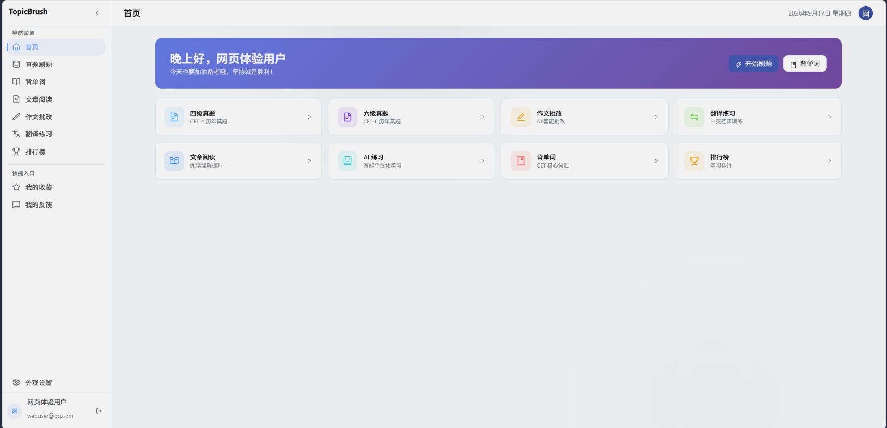
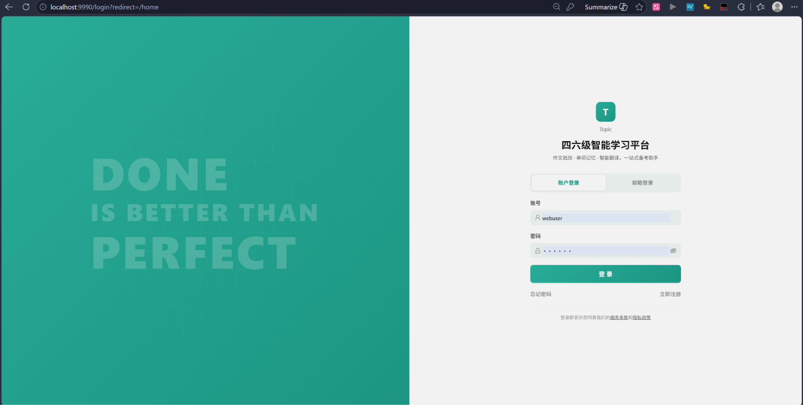
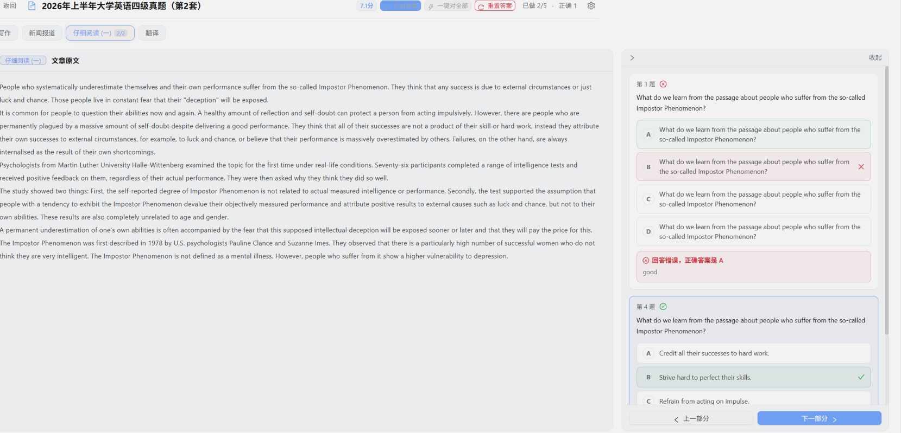
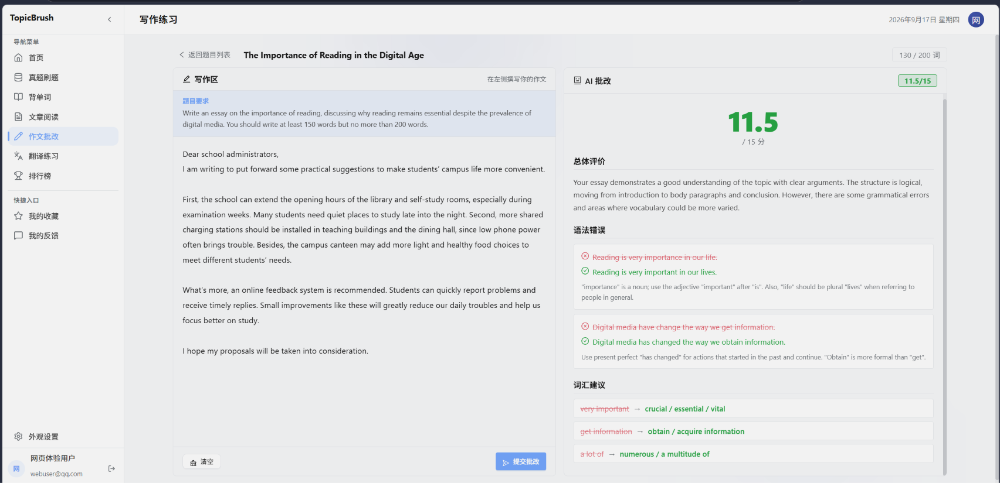
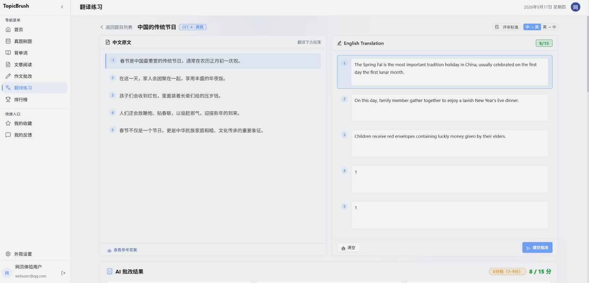
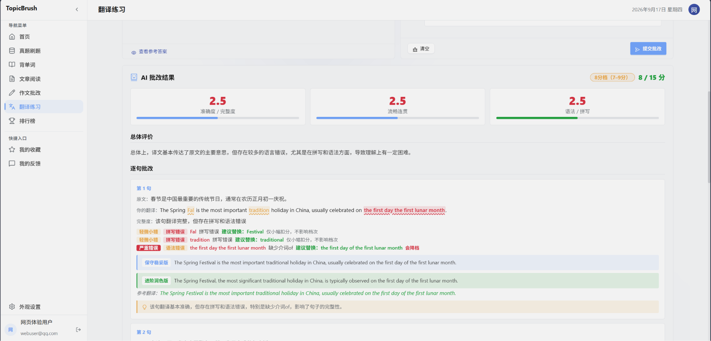
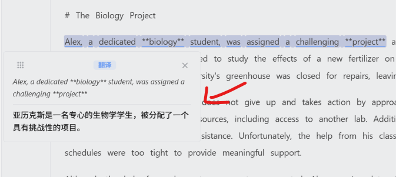
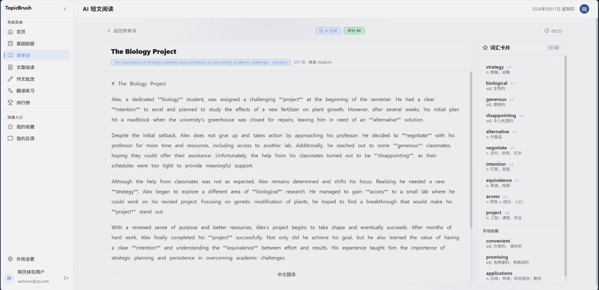
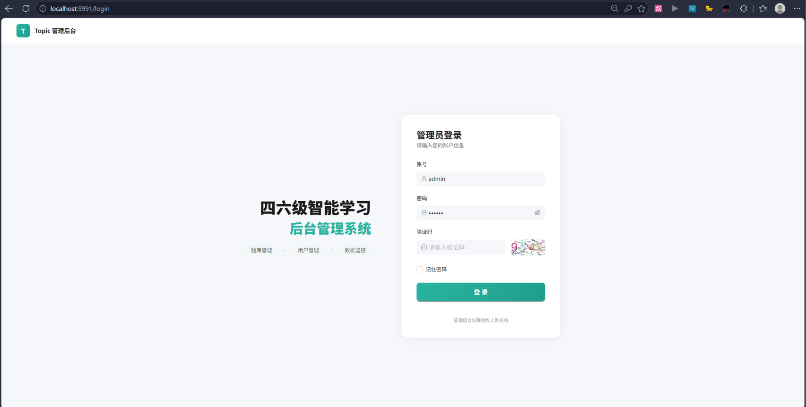
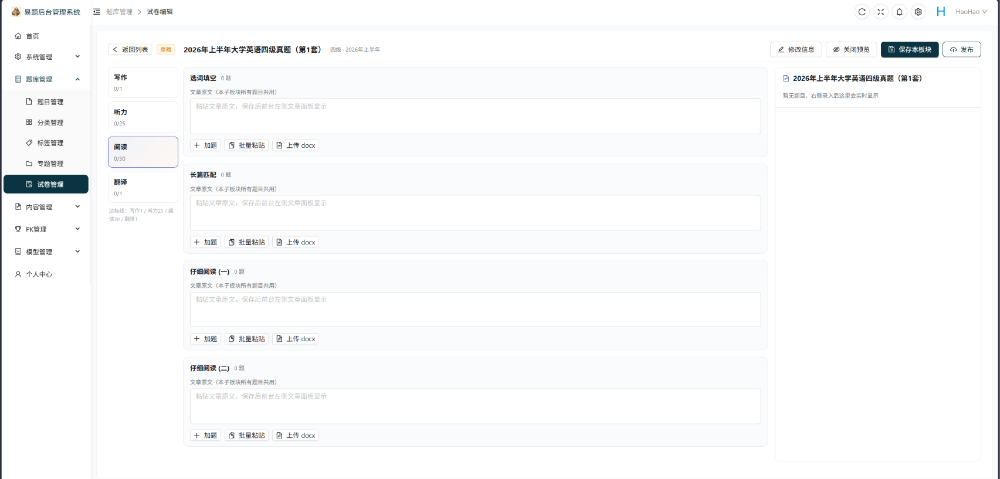

<div align="center">

# 🎯 Topic - 英语学习平台

一款面向求职者与在校学生的 **英语学习平台**，提供题库刷题、每日专属推荐、实时排行榜、背单词、真题试卷、作文批改、翻译练习等核心学习能力。

[](https://spring.io/projects/spring-cloud)
[](https://baomidou.com/)
[](https://redis.io/)
[](LICENSE)

</div>

---

## ✨ 核心特性

- 📊 **实时排行榜** - Redis ZSET 高性能排序，基于背单词打卡天数排名
- 📖 **背单词** - 词书学习、单词复习、打卡记录
- 📝 **真题试卷** - 真题模拟考试环境
- ✍️ **作文批改** - AI 智能批改作文
- 🌐 **翻译练习** - 多语言翻译训练
- 📱 **PC 端 + 管理后台**

---

## 🖼️ 项目截图

### 用户端界面

<table>
  <tr>
    <td align="center"><br><b>首页</b></td>
    <td align="center"><br><b>登录</b></td>
    <td align="center"><br><b>刷题</b></td>
  </tr>
  <tr>
    <td align="center"><br><b>单词</b></td>
    <td align="center"><br><b>作文</b></td>
    <td align="center"><br><b>翻译</b></td>
  </tr>
  <tr>
    <td align="center"><br><b>批改</b></td>
    <td align="center"><br><b>长句</b></td>
    <td align="center"><br><b>AI短文</b></td>
  </tr>
</table>

### 管理后台

<table>
  <tr>
    <td align="center"><br><b>登录</b></td>
    <td align="center"><br><b>试卷</b></td>
  </tr>
</table>

---

## 📦 项目结构

```
Hao-Topic/
├── springcloud-brushtopic-api/         # 后端微服务集群
│   ├── topic-gateway/                  # 网关层
│   │   ├── admin-gateway/              #   管理后台网关 (9992)
│   │   └── web-gateway/                #   用户端网关 (9993)
│   ├── topic-security/                 # 认证服务 (9999)
│   ├── topic-api/                      # 业务服务层
│   │   ├── topic-api-system/           #   系统服务
│   │   └── topic-api-topic/            #   题库服务
│   ├── topic-client/                   # OpenFeign 客户端
│   ├── topic-common/                   # 公共模块
│   └── topic-model/                    # 模型层
├── vue3-ts-brushtopic-web/             # PC 网页端 (9990)
├── vue3-ts-brushtopic-admin/           # 管理后台 (9991)
├── sql/                                # 数据库脚本
├── 配置文件/                            # Nacos 配置
├── docker-compose.yml                  # Docker 编排
└── deploy.sh                           # 部署脚本
```

---

## 🛠️ 技术栈

<div align="center">

| Spring Cloud | MyBatis-Plus | Redis |
|:---:|:---:|:---:|
| ☁️ 微服务架构 | 📦 高效 ORM | ⚡ 高性能缓存 |
| OpenFeign / Gateway / Nacos | CRUD 增强 / 分页 / 代码生成 | 排行榜 / 分布式锁 / 会话缓存 |

</div>

---

### 📦 MyBatis-Plus 数据持久层

| 特性 | 应用场景 |
|:---:|:---|
| 🔧 通用 CRUD | 25+ 张表的快速开发 |
| 📄 分页插件 | 题库、用户列表分页查询 |
| 🎯 条件构造器 | 复杂查询条件构建 |
| 📊 数据导入 | EasyExcel 批量导入题目/用户 |
| 🔄 逻辑删除 | 软删除用户、题目等数据 |

---

### ⚡ Redis 高性能缓存

| 场景 | 数据结构 | 说明 |
|:---:|:---:|:---|
| 🏆 实时排行榜 | ZSET | 基于打卡天数排名，O(1) 查询 |
| 🔒 分布式锁 | STRING | 防止消息重复消费 |
| 📊 统计数据 | STRING | 首页学习统计缓存 |
| 🔑 会话管理 | STRING | JWT Token 黑名单 |

---

### 🖥️ 前端技术

| 端 | 技术栈 |
|:---:|:---|
| PC 网页端 | Vue 3 + Vite 6 + TypeScript + Ant Design Vue 4 + Tailwind CSS 4 |
| 管理后台 | Vue 3 + Vite 6 + TypeScript + Ant Design Vue 4 + ECharts 5 |

---

## 🚀 快速开始

### 📋 前置要求

| 环境 | 版本要求 |
|:---:|:---:|
| JDK | 17+ |
| Node.js | 18+ |
| Maven | 3.8+ |
| MySQL | 8.0+ |
| Redis | 6.0+ |
| Nacos | 2.2+ |

---

### 🔧 后端启动

#### 1. 初始化数据库

```bash
# 导入数据库脚本
mysql -u root -p topic < sql/topic.sql
```

#### 2. 配置 Nacos

```bash
# 启动 Nacos（单机模式）
sh startup.sh -m standalone

# 导入配置文件
# 将 配置文件/ 目录下的 YAML 文件导入 Nacos 配置中心
```

#### 3. 构建公共模块

```bash
cd springcloud-brushtopic-api

# 构建公共模块
mvn clean install -DskipTests -pl topic-common,topic-model,topic-client
```

#### 4. 启动服务（按顺序）

```bash
# 1. 启动认证服务
cd topic-security
mvn spring-boot:run

# 2. 启动业务服务
cd ../topic-api/topic-api-system
mvn spring-boot:run

cd ../topic-api-topic
mvn spring-boot:run

# 3. 启动网关服务
cd ../../topic-gateway/admin-gateway
mvn spring-boot:run

cd ../web-gateway
mvn spring-boot:run
```

---

### 💻 用户端 Web 启动

```bash
cd vue3-ts-brushtopic-web

# 安装依赖
npm install

# 启动开发服务器 (端口 9990)
npm run dev

# 生产构建
npm run build

# 预览构建结果
npm run preview
```

---

### 🖥️ 管理后台启动

```bash
cd vue3-ts-brushtopic-admin

# 安装依赖
npm install

# 启动开发服务器 (端口 9991)
npm run dev

# 生产构建
npm run build

# 代码检查
npm run lint

# 代码格式化
npm run format
```

---

## 🐳 Docker 部署

### 一键部署

```bash
# 1. 配置环境变量
cp .env.example .env
# 编辑 .env 文件，填入真实的密码配置

# 2. 一键启动所有服务
docker-compose up -d --build

# 或使用部署脚本
chmod +x deploy.sh
./deploy.sh
```

### 服务端口一览

| 服务 | 端口 | 说明 |
|:---:|:---:|:---|
| Nginx | 80/443 | 反向代理 |
| MySQL | 3306 | 数据库 |
| Redis | 6379 | 缓存 |
| RabbitMQ | 5672/15672 | 消息队列 |
| Nacos | 8848 | 注册/配置中心 |
| MinIO | 9000/9001 | 对象存储 |
| topic-security | 9999 | 认证服务 |
| admin-gateway | 9992 | 管理后台网关 |
| web-gateway | 9993 | 用户端网关 |
| PC 网页端 | 9990 | 前端开发服务器 |
| 管理后台 | 9991 | 前端开发服务器 |

---

## 🎯 功能模块

### 用户端

| 模块 | 功能 |
|:---:|:---|
| 🏠 首页 | 欢迎横幅、学习统计、打卡记录 |
| 📚 题库 | 分类浏览、专题筛选、标签过滤 |
| ✏️ 刷题 | 题目展示、答案切换、收藏功能 |
| 📝 真题 | 真题试卷、模拟考试 |
| 📖 背单词 | 词书学习、单词复习、打卡记录 |
| ✍️ 作文 | 作文列表、AI 批改 |
| 🌐 翻译 | 翻译练习、多语言支持 |
| 🏆 排行榜 | 基于打卡天数排名、荣誉展示 |
| 👤 我的 | 个人资料、收藏、反馈 |

### 管理后台

| 模块 | 功能 |
|:---:|:---|
| 📊 数据大屏 | 等级分布、打卡 Top10、活跃用户 |
| 👥 系统管理 | 用户/角色/菜单/反馈/公告 |
| 📚 题库管理 | 分类/标签/专题/题目 CRUD |
| 📄 内容管理 | 文章、阅读内容管理 |

---

## 📄 环境变量配置

复制 `.env.example` 为 `.env` 并配置：

```env
# 数据库配置
MYSQL_ROOT_PASSWORD=your_password
MYSQL_DATABASE=topic

# Redis 配置
REDIS_PASSWORD=your_password

# Nacos 配置
NACOS_PASSWORD=your_password

# RabbitMQ 配置
RABBITMQ_DEFAULT_PASS=your_password
```

---

## 📝 更新日志

详见 [CHANGELOG.md](CHANGELOG.md)

---

## 🤝 参与贡献

1. Fork 本仓库
2. 创建功能分支 (`git checkout -b feature/AmazingFeature`)
3. 提交更改 (`git commit -m 'Add some AmazingFeature'`)
4. 推送到分支 (`git push origin feature/AmazingFeature`)
5. 创建 Pull Request

---

## 📄 许可证

本项目基于 [MIT License](LICENSE) 开源。

---

<div align="center">

**⭐ 如果觉得有帮助，欢迎给个 Star 支持一下！⭐**

</div>
